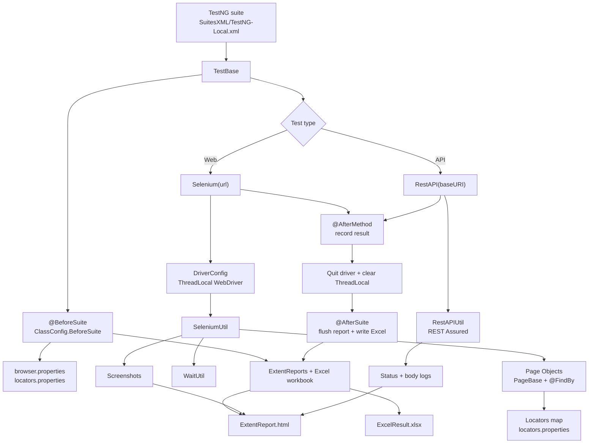

<!--
  Sample README for AutoVD-Java-Selenium.
  Verified against the repository on 2026-11-02:
  pom.xml, SuitesXML/TestNG-Local.xml, src/main/java, src/test/java,
  src/test/resources, and a successful `mvn clean test` run.
-->

<div align="center">

<h1>AutoVD-Java-Selenium</h1>

<p><strong>Hybrid UI + API test automation framework for Java</strong><br>
Selenium WebDriver · TestNG · REST Assured · Page Objects · ExtentReports</p>

<p>
  <a href="https://github.com/KMD-Vignesh/AutoVD-Java-Selenium"></a>
  <a href="https://github.com/KMD-Vignesh/AutoVD-Java-Selenium"></a>
  <a href="https://github.com/KMD-Vignesh/AutoVD-Java-Selenium"></a>
  <a href="https://github.com/KMD-Vignesh/AutoVD-Java-Selenium"></a>
  <a href="https://github.com/KMD-Vignesh/AutoVD-Java-Selenium"></a>
  <a href="https://github.com/KMD-Vignesh/AutoVD-Java-Selenium/blob/main/LICENSE"></a>
</p>

</div>

---

## Author

<div align="center">

<h3>Vignesh D</h3>

<p><strong>Senior Software Quality Analyst</strong><br>Chennai, India</p>

<p>
  <a href="https://www.linkedin.com/in/vigneshdhakshnamoorthy/"></a>
  <a href="https://github.com/KMD-Vignesh"></a>
</p>

<p>
  <a href="mailto:KMD.Vignesh@outlook.com">KMD.Vignesh@outlook.com</a>
  &nbsp;·&nbsp;
  <a href="mailto:VigneshDhakshnamoorthy@gmail.com">VigneshDhakshnamoorthy@gmail.com</a>
</p>

</div>

---

## Project at a Glance

| Item | Details |
| :--- | :--- |
| **Repository** | [KMD-Vignesh/AutoVD-Java-Selenium](https://github.com/KMD-Vignesh/AutoVD-Java-Selenium) |
| **Default branch** | `main` |
| **Version** | `1.0-SNAPSHOT` |
| **Language** | Java 17 |
| **Build tool** | Apache Maven |
| **UI automation** | Selenium WebDriver `4.47.0` |
| **API automation** | REST Assured `5.5.0` |
| **Test runner** | TestNG `7.10.2` |
| **Reporting** | ExtentReports `5.1.2`, Excel via Apache POI `5.3.0`, Surefire HTML |
| **Default browser** | Chrome headless (`chromeheadless`) |
| **Default suite** | [`SuitesXML/TestNG-Local.xml`](SuitesXML/TestNG-Local.xml) |
| **Execution model** | Parallel methods, 5 threads, automatic retry (2 retries) |
| **Data formats** | Excel (`.xlsx`), JSON, properties, plain text |
| **License** | [MIT](LICENSE) |
| **Author** | [Vignesh D](https://www.linkedin.com/in/vigneshdhakshnamoorthy/) |

> **Naming note:** Java packages and a few report labels still use the historical `kmdv` prefix. The repository and the framework family use the **AutoVD** name.

---

## Contents

| Section | Section |
| :--- | :--- |
| [Author](#author) | [Project at a Glance](#project-at-a-glance) |
| [Overview](#overview) | [API Reference](#api-reference) |
| [Key Features](#key-features) | [SeleniumUtil](#seleniumutil) |
| [Architecture](#architecture) | [WaitUtil](#waitutil) |
| [Repository Structure](#repository-structure) | [RestAPIUtil](#restapiutil) |
| [Requirements](#requirements) | [Data Utilities](#data-utilities) |
| [Quick Start](#quick-start) | [PathConfig](#pathconfig) |
| [Configuration](#configuration) | [Dependencies](#dependencies) |
| [Writing Tests](#writing-tests) | [Troubleshooting](#troubleshooting) |
| [Test Data](#test-data) | [License](#license) |
| [Running Tests](#running-tests) | [Reports](#reports) |

---

## Overview

**AutoVD-Java-Selenium** is a hybrid test automation framework for web UI and REST API testing. It wraps Selenium WebDriver in a retry-aware helper layer, manages the TestNG lifecycle, provides page-object support, loads test data from Excel/JSON/properties/text files, and produces both a rich HTML report and an Excel result workbook.

The framework is built to be read as much as it is built to be run:

- **One-line bootstrap.** `Selenium(url)` starts the browser, report, and helper object. `RestAPI(baseURI)` does the same for API tests.
- **One helper library for the repetitive work.** `SeleniumUtil` exposes 185 methods covering navigation, elements, waits, frames, tabs, alerts, JavaScript, dropdowns, actions, keyboard/mouse input, and small data conversions.
- **Page objects that stay small.** `PageBase` injects the driver and `SeleniumUtil`, initializes `@FindBy` fields, and waits for the page to load.
- **Useful output by default.** Every test run produces ExtentReports HTML and an Excel result sheet, plus screenshots for failures and skips (and any pass shots you capture).
- **Parallel by design.** Drivers and helpers live in `ThreadLocal`s, so the bundled suite can run methods in parallel without sharing a browser session.

> **New here?** Jump to [Quick Start](#quick-start), then read [Writing Tests](#writing-tests). The complete helper inventory is in [API Reference](#api-reference).

---

## Key Features

| Capability | What it gives you |
| :--- | :--- |
| **Hybrid UI + API** | Web tests and REST tests can live in the same TestNG suite and share reporting. |
| **185 helper methods** | A single `SeleniumUtil` object covers the common Selenium interactions, including retries. |
| **44 wait wrappers** | `waitUNtil()` exposes Selenium's `ExpectedConditions` with the framework's timeout. |
| **Page Object Model** | `PageBase` + `@FindBy` + a shared `Locators` map keep page classes focused on behaviour. |
| **Thread-safe parallelism** | `ThreadLocal<DriverConfig>` and `ThreadLocal<SeleniumUtil>` isolate each test method. |
| **Retry-aware interactions** | Most helper methods retry for `waitTime` seconds and refresh stale elements before failing. |
| **Automatic screenshots** | Failures and skips are captured in `@AfterMethod`; pass shots are one method call away. |
| **Dual reporting** | ExtentReports for humans, Excel for filtering and trend work, Surefire for raw results. |
| **Data-driven testing** | Read/write Excel, parse JSON into POJOs, load properties, and read text files. |
| **Cross-browser** | Chrome, Firefox, Edge, Safari, and headless Chrome/Firefox from one property. |
| **BrowserStack toggle** | Flip `BrowserStack=on` to run the same tests on BrowserStack Automate. |
| **Zero driver setup** | Selenium 4's Selenium Manager resolves browser drivers automatically. |

---

## Architecture



### Execution lifecycle

1. **`@BeforeSuite` — `TestBase.initialize()`** creates `PathConfig`, ensures the expected folders exist, loads `browser.properties` and `locators.properties`, starts ExtentReports, and opens the Excel result workbook.
2. **Test method** calls `Selenium(webUrl)` or `RestAPI(baseURI)`. This starts an Extent test (using `@Author` when present), creates a thread-local driver/helper, and returns the helper.
3. **Page objects** extend `PageBase`; the constructor injects `selenium` and `driver`, waits for `document.readyState`, and initializes `@FindBy` fields.
4. **`@AfterMethod` — `TestBase.quitBrowser()`** writes one Excel row (index, test name, time, TestNG status, class), captures failure/skip screenshots, quits the browser, and clears thread-local state.
5. **`@AfterSuite` — `TestBase.tearDown()`** flushes ExtentReports and writes/closes the Excel workbook.

---

## Repository Structure

```text
AutoVD-Java-Selenium/
├── pom.xml                              # Maven build, dependencies, Surefire suite
├── LICENSE                              # MIT
├── README.md
├── SuitesXML/
│   └── TestNG-Local.xml                 # Default suite: parallel methods, 5 threads
├── src/
│   ├── main/
│   │   ├── java/
│   │   │   └── kmdv/
│   │   │       ├── Base/
│   │   │       │   ├── PageBase.java    # Page Object base: driver + helper + PageFactory
│   │   │       │   └── TestBase.java    # TestNG lifecycle + data file helpers
│   │   │       ├── Capability/
│   │   │       │   ├── ClassConfig.java # Suite setup, Excel results, screenshots
│   │   │       │   ├── DriverConfig.java # Browser + BrowserStack driver factory
│   │   │       │   └── PathConfig.java  # Project/report/test-data path resolver
│   │   │       ├── Common/
│   │   │       │   ├── BaseUtil.java    # Shared state + Selenium/RestAPI entry points
│   │   │       │   ├── GeneralUtil.java # Static conversions, dates, random values
│   │   │       │   ├── RestAPIUtil.java # REST Assured helper
│   │   │       │   ├── SeleniumUtil.java # 185 helper methods
│   │   │       │   └── WaitUtil.java    # 44 ExpectedConditions wrappers
│   │   │       ├── Data/
│   │   │       │   ├── ExcelUtil.java
│   │   │       │   ├── JsonUtil.java
│   │   │       │   ├── LocatorsUtil.java
│   │   │       │   ├── PropertiesUtil.java
│   │   │       │   └── TextUtil.java
│   │   │       ├── Report/
│   │   │       │   ├── ExtentReportManger.java
│   │   │       │   ├── ScreenShot.java
│   │   │       │   └── SendMail.java
│   │   │       └── config/TestNG/
│   │   │           ├── Author.java      # @Author annotation
│   │   │           ├── RetryAnalyser.java
│   │   │           ├── RetryTransform.java
│   │   │           └── TestID.java      # @TestID annotation
│   │   └── resources/
│   │       └── Images/
│   │           ├── folders.png
│   │           └── framework.png
│   └── test/
│       ├── java/
│       │   ├── pages/SauceLabs/
│       │   │   ├── CartPage.java
│       │   │   ├── CheckoutInform.java
│       │   │   ├── CheckoutOverview.java
│       │   │   ├── HomePage.java
│       │   │   └── LoginPage.java
│       │   └── testCase/
│       │       ├── PojoJSON.java
│       │       ├── demo1.java           # Web + API examples (default suite)
│       │       ├── demo2.java           # Locator-map example
│       │       └── demo3.java           # JSON/POJO example
│       └── resources/
│           ├── Properties/
│           │   ├── browser.properties
│           │   ├── browserStack.properties
│           │   └── locators.properties
│           └── TestData/
│               └── JSON/
│                   └── test.json
├── Report-ScreenShot/                   # generated: Extent, Excel, screenshots
└── target/                              # generated: Maven build + Surefire reports
```

`Report-ScreenShot/` and `target/` are generated and ignored by Git. The framework creates the missing `TestData/Excel`, `TestData/JSON`, `TestData/Text`, and `TestData/Others` folders at suite start.

---

## Requirements

| Requirement | Minimum | Notes |
| :--- | :--- | :--- |
| **JDK** | 17 | `pom.xml` sets `maven.compiler.source/target` to 17 |
| **Maven** | 3.8+ | Verified with Maven 3.9.12 |
| **Browser** | Chrome, Firefox, Edge, or Safari | Install the browser you select in `browser.properties` |
| **Network** | Internet access | The demo tests use `saucedemo.com` and `reqres.in` |
| **Browser drivers** | None | Selenium Manager downloads them on demand |
| **OS** | macOS, Linux, or Windows | Commands below use `open`; use `xdg-open` on Linux or `start` on Windows |
| **Display** | Not required for normal runs | `Robot`/native mouse helpers need a desktop session |

---

## Quick Start

### 1. Clone the repository

```bash
git clone https://github.com/KMD-Vignesh/AutoVD-Java-Selenium.git
cd AutoVD-Java-Selenium
```

### 2. Confirm your toolchain

```bash
java -version
mvn -v
```

The build expects Java 17 or newer. If `mvn -v` reports an older JDK, set `JAVA_HOME` before continuing.

### 3. Run the default suite

```bash
mvn clean test
```

The configured suite is `SuitesXML/TestNG-Local.xml`. It runs three demo scenarios:

- `saucedemo1` — add two products to the SauceDemo cart and capture screenshots.
- `saucedemo2` — add products and assert the cart badge count.
- `getUser` — call the ReqRes API and log the status code and response body.

The default browser is **headless Chrome**, so no browser window is required.

### 4. Open the reports

```bash
open Report-ScreenShot/ExtentReport/ExtentReport.html
open Report-ScreenShot/ExcelReport/ExcelResult.xlsx
open target/surefire-reports/index.html
```

On Linux, replace `open` with `xdg-open`. On Windows, open the files from Explorer or use `start`.

> **First run:** Maven downloads the dependencies and Selenium Manager downloads the matching browser driver. Later runs reuse both caches.

---

## Configuration

All runtime configuration lives in `src/test/resources/Properties/`.

### `browser.properties`

```properties
BrowserName=chromeheadless
waitTime=15
BrowserStack = off
```

| Key | Default | Description |
| :--- | :--- | :--- |
| `BrowserName` | `chromeheadless` | Browser to launch. Values are lowercased when loaded. |
| `waitTime` | `15` | Timeout in seconds. Used for the implicit wait and for the helper retry loops. |
| `BrowserStack` | `off` | Set to `on` to launch the session on BrowserStack instead of locally. |

**Supported `BrowserName` values**

| Value | Browser | Notes |
| :--- | :--- | :--- |
| `chrome` | Google Chrome | Visible window |
| `firefox` | Mozilla Firefox | Visible window |
| `edge` | Microsoft Edge | Visible window |
| `safari` | Apple Safari | macOS only; enable Remote Automation once with `safaridriver --enable` |
| `chromeheadless` | Google Chrome | `--headless=new` |
| `firefoxheadless` | Mozilla Firefox | `-headless` |

Any other value throws `IllegalArgumentException` with the invalid browser name.

### `browserStack.properties`

```properties
USERNAME =
ACCESS_KEY =

os = Windows
os_version = 10

browser = Chrome
browser_version = latest
```

| Key | Description |
| :--- | :--- |
| `USERNAME` | BrowserStack username |
| `ACCESS_KEY` | BrowserStack access key |
| `os` | BrowserStack operating system |
| `os_version` | Operating-system version |
| `browser` | Browser name on BrowserStack |
| `browser_version` | Browser version, or `latest` |

To run on BrowserStack:

1. Put your credentials and target platform in `browserStack.properties`.
2. Set `BrowserStack = on` in `browser.properties`.
3. Run `mvn clean test`.

The framework sets the session name to the TestNG method name and the build name to the test class. The resolution is fixed at `1920x1080` in `DriverConfig`.

### `locators.properties`

```properties
### SauceLab Login Page ###
Username_id = user-name
```

Read a locator in a test or page object:

```java
WebElement username = selenium.getElement(Locators.get("Username_id"));
```

**Key rule:** every key must be `<name>_<strategy>` with **exactly one underscore**. The parser splits on `_` and reads element `[1]` as the strategy.

| Strategy suffix | Example key | Selenium locator |
| :--- | :--- | :--- |
| `id` | `Username_id` | `By.id("user-name")` |
| `name` | `Password_name` | `By.name("password")` |
| `className` | `LoginButton_className` | `By.className("submit-button")` |
| `tagName` | `Heading_tagName` | `By.tagName("h1")` |
| `xpath` | `Cart_xpath` | `By.xpath("//a[@class='shopping_cart_link']")` |
| `cssSelector` | `Cart_cssSelector` | `By.cssSelector(".shopping_cart_link")` |
| `linkText` | `Checkout_linkText` | `By.linkText("Checkout")` |
| `partialLinkText` | `Checkout_partialLinkText` | `By.partialLinkText("Check")` |

> **Careful:** a name containing an underscore (for example `Login_Button_id`) is parsed with `Button` as the strategy and ignored. Keep the locator name underscore-free.

### `waitTime` behaviour

`waitTime` drives both the Selenium implicit wait and the helper retry loops. Most helpers try up to `waitTime * 4` times with a 250 ms pause, which is roughly `waitTime` seconds before the assertion fails. `WaitUtil` uses the same value as its `FluentWait` timeout and polls every 1 second.

---

## Writing Tests

### Minimal web test

Extend `TestBase`, call `Selenium(url)`, and use page objects or `SeleniumUtil` directly.

```java
package testCase;

import org.testng.annotations.Test;

import kmdv.Base.TestBase;
import kmdv.Common.SeleniumUtil;
import kmdv.config.TestNG.Author;
import pages.SauceLabs.HomePage;
import pages.SauceLabs.LoginPage;

public class demo1 extends TestBase {

    @Author(Name = "Vignesh")
    @Test
    public void saucedemo1() {
        SeleniumUtil selenium = Selenium("https://www.saucedemo.com/");

        HomePage home = new LoginPage().Login();

        int cartCount = home.AddProduct("Sauce Labs Onesie").Check_Cart_item_count();
        selenium.Log("Cart count: " + cartCount);
        selenium.elementScreenShot(home.Cart_item_count);
    }
}
```

`Selenium(url)` starts an Extent test, creates a thread-local browser, navigates to the URL, and returns the helper. Teardown is automatic in `@AfterMethod`.

### API test

```java
package testCase;

import org.testng.annotations.Test;

import kmdv.Base.TestBase;
import kmdv.Common.RestAPIUtil;
import kmdv.config.TestNG.Author;

public class demo1 extends TestBase {

    @Author(Name = "Dhakshna")
    @Test
    public void getUser() {
        RestAPIUtil restAPI = RestAPI("https://reqres.in/");

        restAPI.Log(restAPI.getStatusCode("api/users/2"));
        restAPI.Log(restAPI.getBody("api/users/2"));
    }
}
```

Use `getStatusCode(path)` and `getBody(path)` for a specific endpoint, or the no-argument versions to call the configured base URI directly.

### Page objects

```java
package pages.SauceLabs;

import org.openqa.selenium.WebElement;
import org.openqa.selenium.support.FindBy;

import kmdv.Base.PageBase;

public class LoginPage extends PageBase {

    @FindBy(id = "password")
    private WebElement password;

    @FindBy(id = "login-button")
    private WebElement loginButton;

    public HomePage Login() {
        selenium.type(Locators.get("Username_id"), "standard_user");
        selenium.type(password, "secret_sauce");
        selenium.click(loginButton);
        return new HomePage();
    }
}
```

`PageBase` gives every page object:

- `selenium` — the `SeleniumUtil` helper for the current thread.
- `driver` — the raw `WebDriver`, if you need it.
- Automatic `PageFactory.initElements(driver, this)` and `waitPageLoad()`.

Prefer `@FindBy` for stable, page-specific elements and `Locators.get(...)` for shared or configurable locators.

### Assertions

Use TestNG assertions directly; helpers already assert that their own interactions succeeded.

```java
Assert.assertEquals(home.Check_Cart_item_count(), 2);
Assert.assertTrue(selenium.getTitle().contains("Swag Labs"));
```

### Test metadata

```java
@Author(Name = "Vignesh")
@Test
public void checkoutFlow() { /* ... */ }
```

`@Author` is read by the framework and shown in ExtentReports. `@TestID(Name = "TC-101")` is available as a metadata annotation, but the current listeners do not consume it.

### Retries

`RetryTransform` is registered as a suite listener and attaches `RetryAnalyser` to every test. A failed test is retried **twice** (three attempts total). Retry messages appear in the console:

```text
Retry 1 saucedemo1
Retry 2 saucedemo1
```

Retries are useful for genuinely flaky network or rendering steps, but they can hide a real defect. Keep an eye on the retry count in CI logs.

---

## Test Data

| Data type | Folder | Helper from `TestBase` | Utility class |
| :--- | :--- | :--- | :--- |
| Properties | `src/test/resources/Properties` | `fileFromProperties("browser.properties")` | `PropertiesUtil` |
| Excel | `src/test/resources/TestData/Excel` | `fileFromExcelTestData("users.xlsx")` | `ExcelUtil` |
| JSON | `src/test/resources/TestData/JSON` | `fileFromJsonTestData("test.json")` | `JsonUtil` |
| Text | `src/test/resources/TestData/Text` | `fileFromTextTestData("notes.txt")` | `TextUtil` |
| Other | `src/test/resources/TestData/Others` | `pathRoot.fileFromOtherTestData("file.bin")` | — |

The Excel, JSON, Text, and Others folders are created automatically at suite start.

### JSON

The repository includes `src/test/resources/TestData/JSON/test.json`:

```json
{
  "firstName": "vignesh",
  "lastName": "dhakshnamoorthy"
}
```

Read it as a POJO or as raw values:

```java
JsonUtil json = fileFromJsonTestData("test.json");

PojoJSON person = json.getPojo(PojoJSON.class);   // Gson mapping
String first = json.getValue("firstName");        // "vignesh"
Object[] keys = json.getKeys();
Map<String, String> all = json.getAllValues();
```

`getPojo` loads the file from the classpath, so the JSON must live under `src/test/resources`. The path must contain the text `resources` because `JsonUtil` derives the classpath location from it.

### Excel

```java
ExcelUtil excel = fileFromExcelTestData("users.xlsx");

String value = excel.getCellDataByValue("Login", "standard_user", "Username");
String[][] rows = excel.getFullExcelData("Login");

excel.close();
```

`getCellDataByValue(sheet, rowValue, colValue)` finds the row and column by scanning cell values, then returns the intersection. `getFullExcelData(sheet)` treats row `0` as the header and returns the data rows beginning at row `1`.

Row and column indexes in `getCellDataByNum(sheet, row, col)` and `setCellData(sheet, row, col, data)` are **0-based**.

### Properties and text

```java
PropertiesUtil props = fileFromProperties("browser.properties");
String browser = props.getValue("BrowserName");
HashMap<String, String> all = props.getMAP();

TextUtil text = fileFromTextTestData("notes.txt");
List<String> lines = text.readLines();
text.writeLine("new content");   // overwrites the file
```

---

## Running Tests

| Command | What it does |
| :--- | :--- |
| `mvn clean test` | Cleans `target/`, compiles, and runs `SuitesXML/TestNG-Local.xml` |
| `mvn test` | Runs the suite without cleaning |
| `mvn -q test` | Runs quietly; useful when you only want failures |
| `mvn clean test -DskipTests` | Compiles without running tests (useful for a quick build check) |

### Run a subset

The Surefire plugin is configured with a single suite file. To run a subset, edit the `<classes>` block in [`SuitesXML/TestNG-Local.xml`](SuitesXML/TestNG-Local.xml):

```xml
<test name="KMDV Test">
  <classes>
    <class name="testCase.demo1">
      <methods>
        <include name="saucedemo1"/>
        <include name="getUser"/>
      </methods>
    </class>
  </classes>
</test>
```

You can also point the `<suiteXmlFile>` in `pom.xml` at another suite XML.

### Parallel execution

The default suite runs methods in parallel:

```xml
<suite name="KMDV Automation" parallel="methods" thread-count="5">
```

Each test gets its own browser because `DriverConfig` and `SeleniumUtil` are thread-local. Keep test data independent per method; the framework isolates the driver, not your test data.

### Headless vs headed

Set `BrowserName` in `browser.properties`:

```properties
BrowserName=chrome
```

Use `chrome` or `firefox` to watch the run, and `chromeheadless` / `firefoxheadless` for CI.

### BrowserStack

1. Fill in `browserStack.properties`.
2. Set `BrowserStack = on`.
3. Run `mvn clean test`.

The local browser switch is bypassed when BrowserStack is on. Test status is also pushed back to BrowserStack in `@AfterMethod`.

### Report cleanup

At suite start, `ClassConfig.BeforeSuite()` calls `screenShot.cleanFolders()`, which deletes the previous `Report-ScreenShot/` contents and `test-output/` (if present). Each run starts with fresh reports.

---

## Reports

| Output | Location | Contents |
| :--- | :--- | :--- |
| **ExtentReports HTML** | `Report-ScreenShot/ExtentReport/ExtentReport.html` | Test steps, author, device, browser, pass/fail status, screenshots |
| **Excel results** | `Report-ScreenShot/ExcelReport/ExcelResult.xlsx` | One row per test-method execution: index, test name, time, TestNG status, class |
| **Passed screenshots** | `Report-ScreenShot/ScreenShots/Passed/` | `pageScreenShot()` output and element shots |
| **Failed screenshots** | `Report-ScreenShot/ScreenShots/Failed/` | Captured automatically in `@AfterMethod` |
| **Skipped screenshots** | `Report-ScreenShot/ScreenShots/Skipped/` | Captured automatically in `@AfterMethod` |
| **Surefire HTML** | `target/surefire-reports/index.html` | Raw TestNG/Surefire results and stack traces |

Screenshot names use the test method and a timestamp:

```text
Report-ScreenShot/ScreenShots/Passed/saucedemo1-1786559252659.png
Report-ScreenShot/ScreenShots/Passed/saucedemo1-Element-1-1786559252563.png
```

Use `selenium.pageScreenShot()` for a full-page attachment and `selenium.elementScreenShot(element)` for a focused element attachment. Both are attached to the current Extent test.

> ExtentReports is flushed in `@AfterSuite`. If the JVM is killed mid-run, the HTML report may be incomplete.

---

## API Reference

The tables below document every public helper method in the framework. Overloads are grouped in one row. `SeleniumUtil` and `RestAPIUtil` also expose convenience wrappers over `GeneralUtil`.

### Framework Entry Points

| Entry point | Returns | Use |
| :--- | :--- | :--- |
| `Selenium(String webUrl)` | `SeleniumUtil` | Protected static, inherited from `BaseUtil`. Starts an Extent test, creates a thread-local driver, navigates to the URL, and returns the helper. |
| `RestAPI(String baseURI)` | `RestAPIUtil` | Protected static, inherited from `BaseUtil`. Starts an Extent test, sets the REST Assured base URI, and returns the helper. |
| `fileFromProperties(String file)` | `PropertiesUtil` | Opens a file in `src/test/resources/Properties/`. |
| `fileFromExcelTestData(String file)` | `ExcelUtil` | Opens a file in `src/test/resources/TestData/Excel/`. |
| `fileFromJsonTestData(String file)` | `JsonUtil` | Opens a file in `src/test/resources/TestData/JSON/`. |
| `fileFromTextTestData(String file)` | `TextUtil` | Opens a file in `src/test/resources/TestData/Text/`. |
| `@Author(Name = "...")` | Annotation | Adds the author to the Extent test. |
| `@TestID(Name = "...")` | Annotation | Test metadata annotation; reserved, not read by the current listeners. |

### Lifecycle and Support Classes

#### `TestBase`

| Method | Returns | Use |
| :--- | :--- | :--- |
| `initialize()` | `void` | `@BeforeSuite`: creates `ClassConfig` and runs suite setup. |
| `quitBrowser(ITestResult result)` | `void` | `@AfterMethod`: records the result, captures failure/skip screenshots, quits the driver, clears thread-local state. |
| `tearDown()` | `void` | `@AfterSuite`: flushes ExtentReports and writes the Excel workbook. |
| `fileFromProperties(String file)` | `PropertiesUtil` | See [Framework Entry Points](#framework-entry-points). |
| `fileFromExcelTestData(String file)` | `ExcelUtil` | See [Framework Entry Points](#framework-entry-points). |
| `fileFromJsonTestData(String file)` | `JsonUtil` | See [Framework Entry Points](#framework-entry-points). |
| `fileFromTextTestData(String file)` | `TextUtil` | See [Framework Entry Points](#framework-entry-points). |

#### `PageBase`

| Member | Returns | Use |
| :--- | :--- | :--- |
| `PageBase()` | `PageBase` | Injects `selenium` and `driver`, waits for page load, and runs `PageFactory.initElements(driver, this)`. |
| `selenium` | `SeleniumUtil` | Protected field available to every page object. |
| `driver` | `WebDriver` | Protected raw driver. |

#### `ClassConfig`

| Method | Returns | Use |
| :--- | :--- | :--- |
| `BeforeSuite()` | `void` | Resolves paths, creates folders, loads properties/locators, starts Extent and Excel reporting. |
| `AfterMethod(ITestResult, String testType)` | `void` | Writes the Excel result row, captures failure/skip screenshots, updates BrowserStack, quits the driver, clears thread locals. |
| `AfterSuite()` | `void` | Flushes ExtentReports and writes the Excel workbook. |
| `dirCheck()` | `void` | Creates the expected suite, properties, test-data, report, and screenshot folders. |
| `markTestStatus(String status, String reason, WebDriver driver)` | `void` | Sends a BrowserStack session-status update through `browserstack_executor`. |

#### `DriverConfig`

| Method | Returns | Use |
| :--- | :--- | :--- |
| `getDriver()` | `WebDriver` | Returns the thread-local driver, creating it on first access. |
| `quitDriver()` | `void` | Quits the driver and removes it from the thread-local. |
| `browserStackDriver()` | `RemoteWebDriver` | Builds a BrowserStack `RemoteWebDriver` from `browserStack.properties`. |

#### `BaseUtil`

| Method | Returns | Use |
| :--- | :--- | :--- |
| `getInfo(ITestResult result)` | `String[]` | Builds the Extent test metadata: test + class label, class name, and optional `@Author` value. |
| `Selenium(String webUrl)` | `SeleniumUtil` | Entry point described above. |
| `RestAPI(String baseURI)` | `RestAPIUtil` | Entry point described above. |

#### Annotations and listeners

| Type | Use |
| :--- | :--- |
| `@Author(Name = "...")` | Method annotation; adds an author to the Extent test. |
| `@TestID(Name = "...")` | Method annotation; reserved test-ID metadata. |
| `RetryTransform` | `IAnnotationTransformer` registered in the suite; attaches `RetryAnalyser` to every test. |
| `RetryAnalyser` | `IRetryAnalyzer`; retries a failed test twice. |

### SeleniumUtil

`SeleniumUtil` is the primary browser helper. It is created for you by `Selenium(url)`.

**Behaviour to know:** most interaction methods retry for up to `waitTime` seconds, refresh stale elements, and call `Assert.assertTrue(flag)` before returning. A returned `Boolean` is therefore usually `true`; a failed interaction fails the test rather than returning `false`.

#### Session, driver, and logging

| Method | Returns | Use |
| :--- | :--- | :--- |
| `SeleniumUtil(WebDriver driver, ExtentTest test, String browserName, String webUrl, int waitTime)` | `SeleniumUtil` | Wires the helper to a driver and report, sets the implicit wait, clears cookies, maximizes, navigates to the URL, and logs the browser/URL. Prefer `Selenium(url)`. |
| `getDriver()` | `WebDriver` | Raw driver escape hatch. |
| `getMethodName()` | `String` | Current TestNG method name. |
| `getBrowserImage(String browserName)` | `String` | Font Awesome icon markup used in Extent log headers. |
| `Log(Object message)` | `void` | Console + Extent + TestNG Reporter. |
| `Log(Object[] messages)` | `void` | Same, for an array. |
| `logConsole(Object message)` | `void` | Console only. |
| `logConsole(Object[] messages)` | `void` | Console only, for an array. |
| `logExtent(Object message)` | `void` | Extent only. |
| `logExtent(Object[] messages)` | `void` | Extent only, for an array. |
| `logList(List<WebElement> elements)` | `void` | Logs the visible text of every element through `Log`. |
| `logList(By by)` | `void` | Same, after finding elements by locator. |
| `logCList(List<WebElement> elements)` | `void` | Console-only version of `logList`. |
| `logCList(By by)` | `void` | Console-only version of `logList(By)`. |
| `logEList(List<WebElement> elements)` | `void` | Extent-only version of `logList`. |
| `logEList(By by)` | `void` | Extent-only version of `logList(By)`. |

#### Navigation and page information

| Method | Returns | Use |
| :--- | :--- | :--- |
| `navigateTo(String webUrl)` | `void` | `driver.navigate().to(url)` and logs the destination. |
| `refresh()` | `void` | Refreshes the current page. |
| `back()` | `void` | Browser Back. |
| `forward()` | `void` | Browser Forward. |
| `maximize()` | `void` | Maximizes the window. |
| `minimize()` | `void` | Minimizes the window. |
| `windowDimension()` | `Dimension` | Current window dimensions. |
| `screenHeight()` | `int` | Current viewport height. |
| `screenWidth()` | `int` | Current viewport width. |
| `getPageSource()` | `String` | Current page HTML. |
| `getTitle()` | `String` | Current page title. |
| `getCurrentUrl()` | `String` | Current URL. |

#### Tabs, frames, and waits

| Method | Returns | Use |
| :--- | :--- | :--- |
| `currentTab()` | `String` | Handle of the active window/tab. |
| `getTabs()` | `Set<String>` | All open window handles. |
| `countTabs()` | `int` | Number of open windows/tabs. |
| `switchTab(String tab)` | `Boolean` | Switches to a window handle, retrying until the timeout. |
| `switchFrame(String frameName)` | `Boolean` | Resets to default content, then switches by frame name/ID with retries. |
| `switchFrame(int frameIndex)` | `Boolean` | Resets to default content, then switches by index with retries. |
| `parentFrame()` | `void` | Moves to the parent frame. |
| `defaultFrame()` | `void` | Moves to the top-level document. |
| `sleep(int seconds)` | `void` | Hard wait in seconds. Prefer `waitUNtil()`. |
| `sleepMilliSeconds(int milliseconds)` | `void` | Hard wait in milliseconds. |
| `waitPageLoad()` | `Boolean` | Polls `document.readyState == "complete"` until the timeout. |
| `waitUNtil()` | `WaitUtil` | New fluent wait object bound to the driver and `waitTime`. |

#### Find one element

| Method | Returns | Use |
| :--- | :--- | :--- |
| `getElement(By by)` | `WebElement` | Retries `findElement` for up to `waitTime` seconds; logs and asserts if not found. |
| `findBy_Xpath(String xpath)` | `WebElement` | `getElement(By.xpath(...))`. |
| `findBy_ID(String id)` | `WebElement` | `getElement(By.id(...))`. |
| `findBy_LinkText(String linkText)` | `WebElement` | `getElement(By.linkText(...))`. |
| `findBy_CssSelector(String cssSelector)` | `WebElement` | `getElement(By.cssSelector(...))`. |
| `findBy_Name(String name)` | `WebElement` | `getElement(By.name(...))`. |
| `findBy_PartialLinkText(String partialLinkText)` | `WebElement` | `getElement(By.partialLinkText(...))`. |
| `findBy_ClassName(String className)` | `WebElement` | `getElement(By.className(...))`. |
| `findBy_TagName(String tagName)` | `WebElement` | `getElement(By.tagName(...))`. |

#### Find multiple elements

| Method | Returns | Use |
| :--- | :--- | :--- |
| `getElements(By by)` | `List<WebElement>` | Finds all matches; returns an empty list when none match. |
| `findAll_Xpath(String xpath)` | `List<WebElement>` | `getElements(By.xpath(...))`. |
| `findAll_ID(String id)` | `List<WebElement>` | `getElements(By.id(...))`. |
| `findAll_LinkText(String linkText)` | `List<WebElement>` | `getElements(By.linkText(...))`. |
| `findAll_CssSelector(String cssSelector)` | `List<WebElement>` | `getElements(By.cssSelector(...))`. |
| `findAll_Name(String name)` | `List<WebElement>` | `getElements(By.name(...))`. |
| `findAll_PartialLinkText(String partialLinkText)` | `List<WebElement>` | `getElements(By.partialLinkText(...))`. |
| `findAll_ClassName(String className)` | `List<WebElement>` | `getElements(By.className(...))`. |
| `findAll_TagName(String tagName)` | `List<WebElement>` | `getElements(By.tagName(...))`. |

#### Element state, attributes, and shadow DOM

| Method | Returns | Use |
| :--- | :--- | :--- |
| `getBY(WebElement element)` | `By` | Reconstructs a `By` from the element's `toString()` locator. |
| `refreshElement(WebElement element)` | `WebElement` | Re-finds a stale element from its reconstructed locator. |
| `getLocatorString(WebElement element)` | `String[]` | Splits the locator into two parts, e.g. `By.id: user-name` → `["By.id", "user-name"]`. |
| `getLocatorString(By by)` | `String[]` | Same, directly from a `By`. |
| `getShadowRoot(WebElement element)` | `SearchContext` | Opens an element's shadow root. |
| `getShadowRoot(By by)` | `SearchContext` | Finds the host, then opens its shadow root. |
| `getShadowContent(By shadowHost, By shadowContent)` | `WebElement` | Finds an element inside a shadow root. |
| `isDisplayed(By by)` | `boolean` | Visibility check by locator. |
| `isDisplayed(WebElement element)` | `boolean` | Visibility check by element. |
| `isEnabled(By by)` | `boolean` | Enabled check by locator. |
| `isEnabled(WebElement element)` | `boolean` | Enabled check by element. |
| `isSelected(By by)` | `boolean` | Selection check by locator. |
| `isSelected(WebElement element)` | `boolean` | Selection check by element. |
| `getText(WebElement element)` | `String` | Visible text of an element. |
| `getText(By by)` | `String` | Visible text, after finding the element. |
| `getAttribute(WebElement element, String attribute)` | `String` | Attribute value by element. |
| `getAttribute(By by, String attribute)` | `String` | Attribute value by locator. |
| `setAttribute(WebElement element, String attribute, String value)` | `Boolean` | Sets an attribute with JavaScript and verifies the new value. |
| `getLocation(WebElement element)` | `Point` | Element position. |
| `getLocation(By by)` | `Point` | Position of the element found by locator. |

#### Click, type, and clear

| Method | Returns | Use |
| :--- | :--- | :--- |
| `click(WebElement element)` | `Boolean` | Clicks with retries and stale-element refresh. |
| `click(By by)` | `Boolean` | Finds and clicks. |
| `click(locatorType type, String locator)` | `void` | Clicks using the `locatorType` enum instead of a `By`. |
| `clear(WebElement element)` | `Boolean` | Clears an input. |
| `clear(By by)` | `Boolean` | Clears an input found by locator. |
| `type(WebElement element, Object value)` | `Boolean` | Sends `value.toString()` to the element, with retries. |
| `type(By by, Object value)` | `Boolean` | Finds the element, then types. |
| `typeENTER(WebElement element, Object value)` | `Boolean` | Types the value followed by `Keys.ENTER`. |
| `typeENTER(By by, Object value)` | `Boolean` | Finds, then types with Enter. |
| `typeTAB(WebElement element, Object value)` | `Boolean` | Types the value followed by `Keys.TAB`. |
| `typeTAB(By by, Object value)` | `Boolean` | Finds, then types with Tab. |
| `clickSleep(WebElement element, int seconds)` | `void` | Clicks, then hard-waits the given number of seconds. |
| `clickSleep(By by, int seconds)` | `void` | Finds, clicks, then hard-waits. |

`locatorType` values: `XPATH`, `ID`, `LINKTEXT`, `CSSSELECTOR`, `NAME`, `PARTIALLINKTEXT`, `CLASSNAME`.

#### Lists and collections

| Method | Returns | Use |
| :--- | :--- | :--- |
| `clickList(List<WebElement> elements, String clickValue)` | `Boolean` | Clicks the first element whose visible text matches (case-insensitive); asserts a match. |
| `clickList(By by, String clickValue)` | `Boolean` | Finds all matches, then clicks by text. |
| `clickList(List<WebElement> elements, int index)` | `Boolean` | Clicks the element at the given index. |
| `clickList(By by, int index)` | `Boolean` | Finds all matches, then clicks by index. |
| `countList(List<WebElement> elements)` | `int` | Number of elements in the list. |
| `countList(By by)` | `int` | Number of matches for a locator. |
| `getList(List<WebElement> elements)` | `List<String>` | Visible text of every element. |
| `getList(By by)` | `List<String>` | Visible text of every match. |
| `listContains(List<WebElement> elements, String containValue)` | `boolean` | Exact, case-sensitive match against the list's visible text. |
| `listContains(By by, String containValue)` | `boolean` | Same, after finding all matches. |

#### Alerts

| Method | Returns | Use |
| :--- | :--- | :--- |
| `getAlert()` | `Alert` | Waits for and returns the active alert. |
| `acceptAlert()` | `void` | Clicks OK. |
| `dismissAlert()` | `void` | Clicks Cancel. |
| `textAlert()` | `String` | Reads the alert text. |
| `typeAlert(String value)` | `void` | Types into the alert prompt. |

#### JavaScript and scrolling

| Method | Returns | Use |
| :--- | :--- | :--- |
| `jsClick(WebElement element)` | `Boolean` | JavaScript `arguments[0].click()` with retries. |
| `jsClick(By by)` | `Boolean` | Finds the element, then JavaScript-clicks it. |
| `jsType(WebElement element, Object value)` | `Boolean` | Sets the element's `value` property via JavaScript. |
| `jsType(By by, Object value)` | `Boolean` | Finds the element, then sets its value via JavaScript. |
| `executeScript(String script)` | `Boolean` | Executes arbitrary JavaScript and asserts it ran. |
| `executeScript(String script, WebElement element)` | `Boolean` | Executes JavaScript with the element as `arguments[0]`. |
| `scrollIntoView(WebElement element)` | `Boolean` | Scrolls the element into the viewport. |
| `scrollIntoView(By by)` | `Boolean` | Finds the element, then scrolls it into view. |
| `scrollTO_XY(int x, int y)` | `Boolean` | Scrolls the window to the target coordinates in small steps. |
| `scrollTO_XY(Point location)` | `Boolean` | Scrolls to a `Point`. |
| `scrollTO_XY(WebElement element)` | `Boolean` | Scrolls to the element's location. |
| `scrollTO_XY(By by)` | `Boolean` | Finds the element, then scrolls to it. |
| `scrollBY_XY(int x, int y)` | `Boolean` | Scrolls the window by the given offsets in small steps. |
| `scrollBY_XY(Point location)` | `Boolean` | Relative scroll by a `Point`. |
| `scrollBY_XY(WebElement element)` | `Boolean` | Relative scroll by the element's location. |
| `scrollBY_XY(By by)` | `Boolean` | Finds the element, then scrolls by its location. |

#### Dropdowns

| Method | Returns | Use |
| :--- | :--- | :--- |
| `selectDropDown(WebElement element, String visibleText)` | `Boolean` | Selects an option by visible text with retries. |
| `selectDropDown(By by, String visibleText)` | `Boolean` | Finds the `<select>`, then selects by visible text. |
| `getDropDownSelectValue(WebElement element)` | `String` | Returns `Select.getFirstSelectedOption().toString()` — the option element representation, not its visible label. |
| `getDropDownSelectValue(By by)` | `String` | Same, after finding the `<select>`. |

> If you need the selected option's visible label, call `getDropDownSelectValue(...)` only for logging/debugging, or use `new Select(element).getFirstSelectedOption().getText()` directly.

#### Actions (mouse and keyboard)

| Method | Returns | Use |
| :--- | :--- | :--- |
| `moveTo(WebElement element)` | `Boolean` | Hovers over an element. |
| `moveTo(By by)` | `Boolean` | Finds the element, then hovers. |
| `contextClick(WebElement element)` | `Boolean` | Right-clicks an element. |
| `contextClick(By by)` | `Boolean` | Finds the element, then right-clicks. |
| `contextClick()` | `Boolean` | Right-clicks at the current pointer position. |
| `doubleClick(WebElement element)` | `Boolean` | Double-clicks an element. |
| `doubleClick(By by)` | `Boolean` | Finds the element, then double-clicks. |
| `doubleClick()` | `Boolean` | Double-clicks at the current pointer position. |
| `dragAndDrop(WebElement source, WebElement target)` | `Boolean` | Drags source to target with stale-element refresh. |
| `dragAndDrop(By source, By target)` | `Boolean` | Finds both elements, then drags. |
| `actionClick(WebElement element)` | `Boolean` | Actions click on an element. |
| `actionClick(By by)` | `Boolean` | Finds the element, then Actions-clicks. |
| `actionClick()` | `Boolean` | Actions click at the current pointer position. |
| `actionType(WebElement element, Object value)` | `Boolean` | Actions `sendKeys` to an element. |
| `actionType(By by, Object value)` | `Boolean` | Finds the element, then sends keys. |
| `actionType(Object value)` | `Boolean` | Sends keys to the current focus. |
| `actionENTER()` | `Boolean` | Sends `Keys.ENTER` through Actions. |
| `actionESCAPE()` | `Boolean` | Sends `Keys.ESCAPE`. |
| `actionRETURN()` | `Boolean` | Sends `Keys.RETURN`. |
| `actionTAB()` | `Boolean` | Sends `Keys.TAB`. |
| `actionDOWN(int count)` | `Boolean` | Presses the Down arrow `count` times. |
| `actionUP(int count)` | `Boolean` | Presses the Up arrow `count` times. |
| `actionRIGHT(int count)` | `Boolean` | Presses the Right arrow `count` times. |
| `actionLEFT(int count)` | `Boolean` | Presses the Left arrow `count` times. |

#### Robot and native mouse

| Method | Returns | Use |
| :--- | :--- | :--- |
| `robotDOWN(int count)` | `Boolean` | Native Down-arrow press, repeated. |
| `robotUP(int count)` | `Boolean` | Native Up-arrow press, repeated. |
| `robotRIGHT(int count)` | `Boolean` | Native Right-arrow press, repeated. |
| `robotLEFT(int count)` | `Boolean` | Native Left-arrow press, repeated. |
| `robotENTER()` | `Boolean` | Native Enter. |
| `robotTAB()` | `Boolean` | Native Tab. |
| `robotESCAPE()` | `Boolean` | Native Escape. |
| `robotBACKSPACE()` | `Boolean` | Native Backspace. |
| `robotSELECT()` | `Boolean` | Native Ctrl+A (select all). |
| `robotCOPY()` | `Boolean` | Native Ctrl+C. |
| `robotPASTE()` | `Boolean` | Native Ctrl+V. |
| `robotCUT()` | `Boolean` | Native Ctrl+X. |
| `mouseLeftClick()` | `Boolean` | Native left click at the current pointer. |
| `mouseRightClick()` | `Boolean` | Native right click at the current pointer. |
| `mouseMove(int x, int y)` | `Boolean` | Native mouse move to screen coordinates. |
| `mouseMove(Point location)` | `Boolean` | Native mouse move to a `Point`. |
| `mouseMove(WebElement element)` | `Boolean` | Native mouse move to an element's location. |
| `mouseMove(By by)` | `Boolean` | Finds the element, then moves the native pointer. |

> Robot and native mouse methods use `java.awt.Robot`. They need a real desktop session and do not work in headless-only CI environments.

#### Conversions and utility

| Method | Returns | Use |
| :--- | :--- | :--- |
| `IntToString(int value)` | `String` | `Integer.toString(value)`. |
| `StringToInt(String value)` | `int` | `Integer.parseInt(value)`. |
| `compare(String value1, String value2)` | `boolean` | Case-insensitive equality. |
| `compare(int value1, int value2)` | `int` | `Integer.compare(...)`. |
| `compare(Double value1, Double value2)` | `int` | `Double.compare(...)`. |
| `Today()` | `LocalDate` | Current date. |
| `Yesterday()` | `LocalDate` | Current date minus one day. |
| `Tomorrow()` | `LocalDate` | Current date plus one day. |
| `localDate(int year, int month, int day)` | `LocalDate` | Builds a specific date. |
| `toCharArray(String value)` | `String[]` | Each character as a one-character string. |
| `toCharArray(int value)` | `int[]` | Each digit of the integer. |
| `getRandom(int min, int max)` | `int` | Random integer in the inclusive range. |
| `getRandom(int[] array)` | `int` | Random element from an integer array. |
| `getRandom(String[] array)` | `String` | Random element from a string array. |
| `replaceBetweenDelimiters(String input, String startDelimiter, String endDelimiter, String replacement)` | `String` | Replaces the first substring between two delimiters. |

### WaitUtil

`waitUNtil()` returns a `WaitUtil` configured with the suite timeout. It polls every 1 second and ignores `NoSuchElementException`, `ElementNotInteractableException`, `StaleElementReferenceException`, and `NoSuchFrameException`.

#### Presence and visibility

| Method | Returns | Waits until |
| :--- | :--- | :--- |
| `alertIsPresent()` | `Alert` | An alert is present. |
| `presenceOfElementLocated(By by)` | `WebElement` | The element exists in the DOM. |
| `presenceOfAllElementsLocatedBy(By by)` | `List<WebElement>` | At least one matching element exists. |
| `presenceOfNestedElementLocatedBy(By parent, By child)` | `WebElement` | A nested element exists. |
| `presenceOfNestedElementsLocatedBy(By parent, By child)` | `List<WebElement>` | Nested elements exist. |
| `visibilityOf(WebElement element)` | `WebElement` | The element is visible. |
| `visibilityOfAllElements(List<WebElement> elements)` | `List<WebElement>` | All elements are visible. |
| `visibilityOfElementLocated(By by)` | `WebElement` | The located element is visible. |
| `visibilityOfAllElementsLocatedBy(By by)` | `List<WebElement>` | All located elements are visible. |
| `visibilityOfNestedElementsLocatedBy(By parent, By child)` | `List<WebElement>` | Nested located elements are visible. |

#### Click, selection, and state

| Method | Returns | Waits until |
| :--- | :--- | :--- |
| `elementToBeClickable(By by)` | `WebElement` | The element is visible and enabled. |
| `elementToBeClickable(WebElement element)` | `WebElement` | The element is clickable. |
| `elementToBeSelected(By by)` | `Boolean` | The element is selected. |
| `elementToBeSelected(WebElement element)` | `Boolean` | The element is selected. |
| `elementSelectionStateToBe(By by, boolean selected)` | `Boolean` | The element's selection state matches. |
| `elementSelectionStateToBe(WebElement element, boolean selected)` | `Boolean` | The element's selection state matches. |

#### Text, attributes, and values

| Method | Returns | Waits until |
| :--- | :--- | :--- |
| `attributeContains(By by, String attribute, String value)` | `Boolean` | The attribute contains the value. |
| `attributeContains(WebElement element, String attribute, String value)` | `Boolean` | The attribute contains the value. |
| `attributeToBe(By by, String attribute, String value)` | `Boolean` | The attribute equals the value. |
| `attributeToBe(WebElement element, String attribute, String value)` | `Boolean` | The attribute equals the value. |
| `attributeToBeNotEmpty(WebElement element, String attribute)` | `Boolean` | The attribute is non-empty. |
| `textToBe(By by, String value)` | `Boolean` | The element's text equals the value. |
| `textToBePresentInElementLocated(By by, String value)` | `Boolean` | The located element's text contains the value. |
| `textToBePresentInElement(WebElement element, String value)` | `Boolean` | The element's text contains the value. |
| `textToBePresentInElementValue(WebElement element, String value)` | `Boolean` | The element's value contains the value. |

#### Disappearance and staleness

| Method | Returns | Waits until |
| :--- | :--- | :--- |
| `invisibilityOf(WebElement element)` | `Boolean` | The element is invisible or gone. |
| `invisibilityOfAllElements(List<WebElement> elements)` | `Boolean` | All elements are invisible. |
| `invisibilityOfElementLocated(By by)` | `Boolean` | The located element is invisible or gone. |
| `invisibilityOfElementWithText(By by, String value)` | `Boolean` | The element with the given text is invisible or gone. |
| `stalenessOf(WebElement element)` | `Boolean` | The element is stale (detached from the DOM). |

#### Counts, windows, frames, and page state

| Method | Returns | Waits until |
| :--- | :--- | :--- |
| `numberOfElementsToBe(By by, int count)` | `List<WebElement>` | Exactly `count` elements match. |
| `numberOfElementsToBeLessThan(By by, int count)` | `List<WebElement>` | Fewer than `count` elements match. |
| `numberOfElementsToBeMoreThan(By by, int count)` | `List<WebElement>` | More than `count` elements match. |
| `numberOfWindowsToBe(int count)` | `Boolean` | Exactly `count` windows are open. |
| `frameToBeAvailableAndSwitchToIt(By by)` | `WebDriver` | The frame is available and selected. |
| `frameToBeAvailableAndSwitchToIt(String nameOrId)` | `WebDriver` | The named frame is available and selected. |
| `frameToBeAvailableAndSwitchToIt(int index)` | `WebDriver` | The indexed frame is available and selected. |
| `frameToBeAvailableAndSwitchToIt(WebElement element)` | `WebDriver` | The frame element is available and selected. |
| `titleContains(String value)` | `Boolean` | The page title contains the value. |
| `titleIs(String value)` | `Boolean` | The page title equals the value. |
| `urlContains(String value)` | `Boolean` | The URL contains the value. |
| `urlToBe(String value)` | `Boolean` | The URL equals the value. |
| `javaScriptThrowsNoExceptions(String script)` | `Boolean` | The script runs without throwing. |
| `jsReturnsValue(String script)` | `Object` | The script returns a non-null value. |

### RestAPIUtil

Created by `RestAPI(baseURI)`. The helper uses REST Assured's static `given()` API and logs to Extent when configured.

| Method | Returns | Use |
| :--- | :--- | :--- |
| `RestAPIUtil(String baseURI, ExtentTest test)` | `RestAPIUtil` | Sets `RestAssured.baseURI` and binds the Extent test. Prefer `RestAPI(baseURI)`. |
| `getMethodName()` | `String` | Current TestNG method name. |
| `Log(Object message)` | `void` | Console + Extent + TestNG Reporter. |
| `logC(Object message)` | `void` | Console only. |
| `logE(Object message)` | `void` | Extent only. |
| `IntToString(int value)` | `String` | Delegates to `GeneralUtil`. |
| `StringToInt(String value)` | `int` | Delegates to `GeneralUtil`. |
| `StringEquals(String value1, String value2)` | `boolean` | Case-insensitive equality. |
| `Today()` | `LocalDate` | Current date. |
| `Yesterday()` | `LocalDate` | Current date minus one day. |
| `Tomorrow()` | `LocalDate` | Current date plus one day. |
| `localDate(int year, int month, int day)` | `LocalDate` | Builds a specific date. |
| `toCharArray(String value)` | `String[]` | Characters as strings. |
| `toCharArray(int value)` | `int[]` | Digits as integers. |
| `getRandom(int min, int max)` | `int` | Random integer in the inclusive range. |
| `getStatusCode(String path)` | `int` | GET the path relative to `baseURI`, return the status code. |
| `getStatusCode()` | `int` | GET the base URI, return the status code. |
| `getBody(String path)` | `String` | GET the path relative to `baseURI`, return a pretty-printed body. |
| `getBody()` | `String` | GET the base URI, return a pretty-printed body. |

> `StringEquals` lives on `RestAPIUtil` and `GeneralUtil`, not on `SeleniumUtil`.

### GeneralUtil

Static helpers. `SeleniumUtil` and `RestAPIUtil` expose wrappers for most of them.

| Method | Returns | Use |
| :--- | :--- | :--- |
| `IntToString(int value)` | `String` | Integer to string. |
| `StringToInt(String value)` | `int` | String to integer. |
| `StringEquals(String value1, String value2)` | `boolean` | Case-insensitive equality. |
| `Today()` | `LocalDate` | Current date. |
| `Yesterday()` | `LocalDate` | Current date minus one day. |
| `Tomorrow()` | `LocalDate` | Current date plus one day. |
| `localDate(int year, int month, int day)` | `LocalDate` | Specific date. |
| `toCharArray(String value)` | `String[]` | Characters as one-character strings. |
| `toCharArray(int value)` | `int[]` | Digits of the integer. |
| `getRandom(int min, int max)` | `int` | Random integer in the inclusive range. |
| `getRandom(int[] array)` | `int` | Random array element. |
| `getRandom(String[] array)` | `String` | Random array element. |

### Data Utilities

#### ExcelUtil

| Method | Returns | Use |
| :--- | :--- | :--- |
| `ExcelUtil(String excelPath)` | `ExcelUtil` | Opens an `.xlsx` workbook for reading. |
| `getCellDataByValue(String sheetName, String rowName, String colName)` | `String` | Finds the row and column by scanning values, then returns the cell. The last match wins. |
| `getFullExcelData(String sheetName)` | `String[][]` | Returns data rows starting at row `1` (row `0` is treated as the header). |
| `getRowNumber(String sheetName, String value)` | `int` | Finds the row index of a value. |
| `getColumnNumber(String sheetName, String value)` | `int` | Finds the column index of a value. |
| `getRowCount(String sheetName)` | `int` | `getLastRowNum()` for the sheet. |
| `getCellCount(String sheetName, int rowNum)` | `int` | `getLastCellNum()` for the row. |
| `getCellDataByNum(String sheetName, int rowNum, int colNum)` | `String` | Formatted cell value; row and column are 0-based. |
| `close()` | `void` | Closes the workbook and input stream. |
| `setCellData(String sheetName, int rowNum, int colNum, String data)` | `void` | Creates the file/sheet/row/cell if needed, writes the value, and closes the workbook. |
| `xbookClose()` | `void` | Closes the workbook. |
| `finClose()` | `void` | Closes the input stream. |
| `foutClose()` | `void` | Closes the output stream. |

#### JsonUtil

| Method | Returns | Use |
| :--- | :--- | :--- |
| `JsonUtil(String jsonLocation)` | `JsonUtil` | Parses the JSON file and remembers its classpath location. |
| `getPojo(Class<T> clazz)` | `T` | Maps the JSON to a POJO with Gson. The file must be under `src/test/resources`. |
| `getObject()` | `JSONObject` | Root JSON object. |
| `getValue(String jsonKey)` | `String` | String value for a top-level key. |
| `getKeys()` | `Object[]` | Top-level keys. |
| `getAllValues()` | `Map<String, String>` | All top-level key/value pairs, sorted by key. |
| `getArray(String arrayKey)` | `JSONArray` | Array value for a key. |
| `getObjFromArray(JSONArray array, int index)` | `JSONObject` | Object at an array index. |

#### PropertiesUtil

| Method | Returns | Use |
| :--- | :--- | :--- |
| `PropertiesUtil(String propertyPath)` | `PropertiesUtil` | Loads a `.properties` file. Creates defaults if `browser.properties` or `browserStack.properties` is missing. |
| `getValue(String propertyName)` | `String` | Property value. |
| `getKeys()` | `Set<Object>` | All property keys. |
| `getMAP()` | `HashMap<String, String>` | All key/value pairs as a map. |

#### TextUtil

| Method | Returns | Use |
| :--- | :--- | :--- |
| `TextUtil(String filePath)` | `TextUtil` | Binds a text file path. |
| `readLines()` | `List<String>` | Reads all lines. |
| `writeLine(String value)` | `void` | Writes a string, overwriting the file. |
| `writeLine(int value)` | `void` | Writes an integer as text, overwriting the file. |

#### LocatorsUtil

| Method | Returns | Use |
| :--- | :--- | :--- |
| `LocatorsUtil(String locatorsPath)` | `LocatorsUtil` | Loads `locators.properties` and populates the shared `Locators` map with `By` objects. Creates the file with a header if it is missing. |

### Reporting Utilities

#### ExtentReportManger

| Method | Returns | Use |
| :--- | :--- | :--- |
| `StartExtentReport()` | `void` | Creates the Extent report at `Report-ScreenShot/ExtentReport/ExtentReport.html`. |
| `getTestThread()` | `ExtentTest` | Returns the current thread's Extent test. |
| `StartExtentTest(String[] infoNames)` | `void` | Creates a test from `[name, category, author]` metadata. |
| `StartExtentTest(String testName)` | `void` | Creates a test by name. |
| `removeThread()` | `void` | Removes the thread-local Extent test. |
| `EndExtentReport()` | `void` | Flushes the report to disk. |

#### ScreenShot

| Method | Returns | Use |
| :--- | :--- | :--- |
| `ExtentFailShot(WebDriver driver, ITestResult result, ExtentTest test)` | `void` | Saves a failure screenshot to `ScreenShots/Failed/` and attaches it to Extent. |
| `ExtentSkipShot(WebDriver driver, ITestResult result, ExtentTest test)` | `void` | Saves a skip screenshot to `ScreenShots/Skipped/` and attaches it. |
| `ExtentPassShot(WebDriver driver, ExtentTest test, String testName)` | `void` | Saves a pass screenshot to `ScreenShots/Passed/` and attaches it. |
| `ExtentElementShot(WebElement element, ExtentTest test, String testName)` | `void` | Saves an element-only screenshot to `ScreenShots/Passed/` and attaches it. |
| `deleteReportScreenShot()` | `void` | Deletes the contents of `Report-ScreenShot/`. |
| `deleteFolder(File folder)` | `void` | Recursively deletes a folder's contents. |
| `deleteTestOutput()` | `void` | Deletes the contents of `test-output/` if present. |
| `cleanFolders()` | `void` | Calls both cleanup methods at suite start. |

#### SendMail

| Method | Returns | Use |
| :--- | :--- | :--- |
| `SendMail(String host, String port, String from, String pass, String to, String subject, String body, String attachment)` | `SendMail` | Sends an SMTP email with an attachment when constructed. |

> Keep credentials out of source control. Pass them from environment variables or a local, ignored properties file if you use `SendMail`.

### PathConfig

`PathConfig` is available as the protected static `pathRoot` in `TestBase` subclasses. Each area has a folder getter and a `fileFrom...` helper. All methods return `String` absolute paths.

| Area | Getter | File helper | Resolves to |
| :--- | :--- | :--- | :--- |
| Project root | `getProjectPath()` | `fileFromProject(String)` | Repository root |
| Test output | `getTestOutputPath()` | `fileFromTestOutput(String)` | `test-output/` |
| Suites | `getSuitesXMLPath()` | `fileFromSuitesXML(String)` | `SuitesXML/` |
| Resources | `getResourcesPath()` | `fileFromResources(String)` | `src/test/resources/` |
| Images | `getImagesPath()` | `fileFromImages(String)` | `src/main/resources/Images/` |
| Properties | `getPropertiesPath()` | `fileFromProperties(String)` | `src/test/resources/Properties/` |
| Test data | `getTestDataPath()` | `fileFromTestData(String)` | `src/test/resources/TestData/` |
| Excel data | `getExcelTestDataPath()` | `fileFromExcelTestData(String)` | `src/test/resources/TestData/Excel/` |
| JSON data | `getJsonTestDataPath()` | `fileFromJsonTestData(String)` | `src/test/resources/TestData/JSON/` |
| Text data | `getTextTestDataPath()` | `fileFromTextTestData(String)` | `src/test/resources/TestData/Text/` |
| Other data | `getOtherTestDataPath()` | `fileFromOtherTestData(String)` | `src/test/resources/TestData/Others/` |
| Reports root | `getReportScreenShotPath()` | `fileFromReportScreenShot(String)` | `Report-ScreenShot/` |
| Extent report | `getExtentReportPath()` | `fileFromExtentReport(String)` | `Report-ScreenShot/ExtentReport/` |
| Excel report | `getExcelReportPath()` | `fileFromExcelReport(String)` | `Report-ScreenShot/ExcelReport/` |
| Screenshots | `getScreenShotPath()` | `fileFromScreenShot(String)` | `Report-ScreenShot/ScreenShots/` |
| Passed shots | `getPassedShotPath()` | `fileFromPassedShot(String)` | `Report-ScreenShot/ScreenShots/Passed/` |
| Failed shots | `getFailedShotPath()` | `fileFromFailedShot(String)` | `Report-ScreenShot/ScreenShots/Failed/` |
| Skipped shots | `getSkippedShotPath()` | `fileFromSkippedShot(String)` | `Report-ScreenShot/ScreenShots/Skipped/` |

---

## Dependencies

| Dependency | Version | Scope | Used for |
| :--- | :--- | :--- | :--- |
| [`org.seleniumhq.selenium:selenium-java`](https://mvnrepository.com/artifact/org.seleniumhq.selenium/selenium-java) | `4.47.0` | compile | Browser automation and Selenium Manager |
| [`org.testng:testng`](https://mvnrepository.com/artifact/org.testng/testng) | `7.10.2` | compile | Test lifecycle, assertions, parallel execution, retries |
| [`org.apache.poi:poi`](https://mvnrepository.com/artifact/org.apache.poi/poi) | `5.3.0` | compile | Excel result workbook |
| [`org.apache.poi:poi-ooxml`](https://mvnrepository.com/artifact/org.apache.poi/poi-ooxml) | `5.3.0` | compile | `.xlsx` support |
| [`com.aventstack:extentreports`](https://mvnrepository.com/artifact/com.aventstack/extentreports) | `5.1.2` | compile | HTML reporting |
| [`com.googlecode.json-simple:json-simple`](https://mvnrepository.com/artifact/com.googlecode.json-simple/json-simple) | `1.1.1` | compile | JSON parsing |
| [`javax.mail:mail`](https://mvnrepository.com/artifact/javax.mail/mail) | `1.4.5` | compile | Optional email report |
| [`io.rest-assured:rest-assured`](https://mvnrepository.com/artifact/io.rest-assured/rest-assured) | `5.5.0` | compile | API testing |
| [`org.slf4j:slf4j-simple`](https://mvnrepository.com/artifact/org.slf4j/slf4j-simple) | `1.7.36` | test | SLF4J binding |
| [`org.apache.logging.log4j:log4j-core`](https://mvnrepository.com/artifact/org.apache.logging.log4j/log4j-core) | `2.23.1` | test | Log4j2 implementation |
| [`com.google.code.gson:gson`](https://mvnrepository.com/artifact/com.google.code.gson/gson) | `2.10.1` | transitive | JSON → POJO mapping in `JsonUtil.getPojo(...)` |
| [`commons-io:commons-io`](https://mvnrepository.com/artifact/commons-io/commons-io) | `2.16.1` | transitive | Classpath resource reading in `JsonUtil` |

> The first ten rows are declared in `pom.xml`. Gson and Commons IO are used directly by `JsonUtil` but currently arrive transitively; declare them explicitly if you tighten dependency management.

### Build configuration

| Item | Value |
| :--- | :--- |
| Java source/target | `17` |
| Maven Surefire Plugin | `3.0.0-M4` |
| Suite file | `SuitesXML/TestNG-Local.xml` |
| Driver management | Selenium Manager (bundled with Selenium 4) |
| WebDriverManager | Not used |

---

## Troubleshooting

| Symptom | Likely cause | Fix |
| :--- | :--- | :--- |
| `mvn: command not found` | Maven is not installed or not on `PATH` | Install Maven 3.8+ and reopen the terminal. |
| `invalid target release: 17` | Maven is running on an older JDK | Point `JAVA_HOME` at JDK 17+ and check `mvn -v`. |
| `IllegalArgumentException: Update Proper BrowserName` | Unknown `BrowserName` value | Use one of `chrome`, `firefox`, `edge`, `safari`, `chromeheadless`, `firefoxheadless`. |
| Browser session is not created | Browser not installed or driver download blocked | Install the browser, check network/proxy access, or try another browser. |
| `Element Not Found` | Wrong locator, frame, or slow page | Verify the locator, switch frames, raise `waitTime`, or use `waitUNtil()`. |
| Locator from `locators.properties` is ignored | Key does not have exactly one underscore or has an invalid strategy | Rename to `<name>_<strategy>` and use a supported suffix. |
| `NullPointerException` in `JsonUtil.getPojo` | JSON is not on the classpath | Put the file under `src/test/resources/TestData/JSON/` and pass it through `fileFromJsonTestData(...)`. |
| Wrong Excel cell returned | Row/column indexes are 0-based; values may repeat | Check `getCellDataByNum` indexes and make the lookup value unique. |
| BrowserStack session fails | Missing credentials, wrong platform, or `BrowserStack` is off | Fill in `browserStack.properties`, set `BrowserStack = on`, and verify the OS/browser values. |
| Safari session fails | Remote Automation is disabled | Run `safaridriver --enable` once, or use Chrome/Firefox. |
| Extent report is empty or incomplete | The JVM was killed before `@AfterSuite` | Let the suite finish; `EndExtentReport()` flushes the report. |
| `HeadlessException` from Robot/mouse helpers | No desktop display | Run those tests on a machine with a display, or avoid native input in headless CI. |
| `Unable to find an exact match for CDP version` warning | Chrome is newer than the Selenium CDP bindings | Usually harmless; update Selenium when a compatible release is available. |
| Parallel tests interfere with each other | Shared test data or shared application state | Keep data per method; the driver is thread-local, but your data is not. |

---

## License

Distributed under the **MIT License**. See [`LICENSE`](LICENSE) for the full text.

```text
MIT License

Copyright (c) 2024 Vignesh D
```
